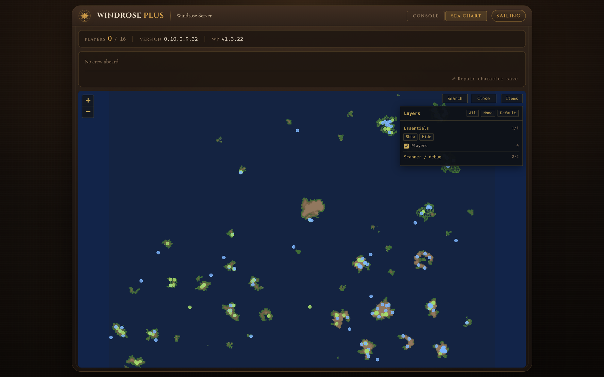
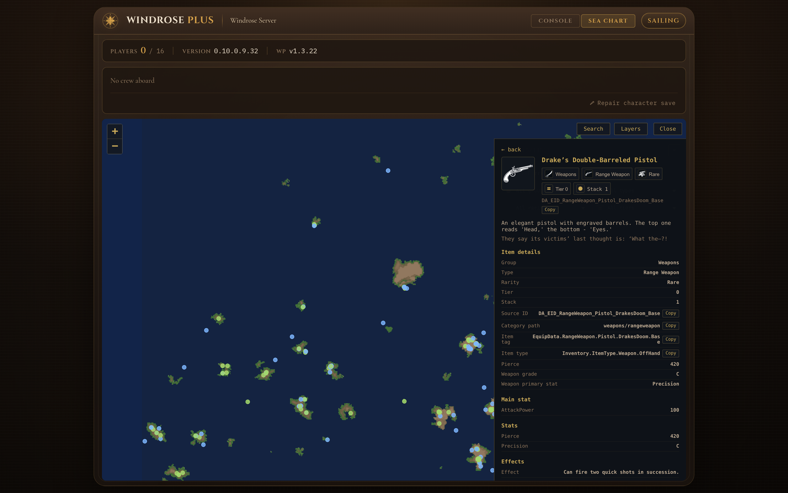
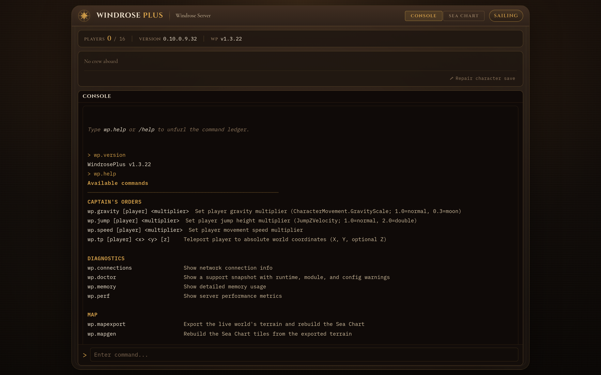

<p align="center">
  <picture>
    <source media="(prefers-color-scheme: dark)" srcset="docs/brand/windroseplus-landscape-dark.png">
    
  </picture>
</p>

<p align="center">
  <a href="LICENSE"></a>
  <a href="https://github.com/UE4SS-RE/RE-UE4SS"></a>
  <a href="https://store.steampowered.com/app/3041230/"></a>
  <a href="#features"></a>
</p>

# Windrose+

The Windrose dedicated server has difficulty settings, but no XP or loot rates, no admin console and no map. Windrose+ is a Windrose dedicated server mod that adds them: XP and loot multipliers, 2,400+ server settings, a live map, a console in your browser and Lua mods. It runs on the server only, so your players join with the normal game.

_Windrose+ is a community project and is not affiliated with or endorsed by the developers of Windrose._

## Table of Contents

- [Features](#features)
- [Install](#install)
- [Settings](#settings)
- [Commands](#commands)
- [Getting help](#getting-help)
- [Contributing](#contributing)
- [License](#license)
- [Credits](#credits)

## Features

### Live map

The Sea Chart is a live map of your server in the browser: island terrain, players, creatures and the points of interest the mod finds, refreshed every 10 seconds. Pick a player and click the map to teleport them. Turn on the [public view](#share-the-map) to show the map to friends without giving them the console password.



### Item and recipe search

Browse every item in the game by group, type, rarity and tier. An item's page shows its stats, effects, crafting recipes and stations, trader offers, building costs, research unlocks and where it drops. The dashboard builds this list on your server from your own copy of the game in about a minute, so it matches the game version you run and rebuilds itself after a game update. Nothing from the game ships with Windrose+.



### Server console

Run commands from your browser with autocomplete: see who's online, read server stats and performance, teleport players. 32 built-in commands, plus 12 debug commands listed by `wp.help all`.



### Also built in

- **XP and loot multipliers:** XP, loot, crafting cost, cooking speed and harvest yield, in one file ([Settings](#settings)).
- **2,400+ server settings:** player stats, weapons, food, gear, creatures, co-op scaling, swimming and rest bonuses ([full list](docs/config-reference.md)).
- **Player count for bots and monitoring tools:** Windrose dedicated servers don't answer standard server queries. Windrose+ writes the player list and server status to a file every 5 seconds (every 30 with nobody online) and serves it at `/api/status` ([example](docs/commands.md#get-apistatus)). It does not make the server answer server-browser queries.
- **Character repair:** a character stuck on the known progression bug can be fixed from the dashboard. Upload a zip of the local save folder and download a repaired copy.
- **Lua mods:** add commands, scheduled tasks and player join and leave hooks ([scripting guide](docs/scripting-guide.md)).
- **Activity log:** joins, leaves, console commands and config changes, one line of JSON per event ([format](docs/scripting-guide.md#activity-log)).

<a name="installation"></a>
## Install

### Rent a server

[Rent a Windrose server](https://www.survivalservers.com/services/game_servers/windrose/?utm_source=github&utm_medium=readme&utm_campaign=windrose_plus). Survival Servers game servers come with Windrose+ already installed.

### Install on your server

You need a Windrose Dedicated Server on Windows.

1. Download `WindrosePlus.zip` from the latest [GitHub Release](https://github.com/HumanGenome/WindrosePlus/releases/latest). Do not use GitHub's "Source code" zip: `tools/bin/repak.exe` and `tools/bin/retoc.exe` are in the release zip only.
2. Extract the zip into your Windrose Dedicated Server folder (e.g. `C:\WindroseServer\`).
3. Open PowerShell in that folder and run:

```powershell
.\install.ps1
```

If PowerShell refuses to run it (scripts are blocked by default on Windows, and a zip downloaded with a browser is marked as from the internet), run `powershell -NoProfile -ExecutionPolicy Bypass -File .\install.ps1` instead.

This downloads UE4SS (the exact build Windrose+ is tested with, checked against its SHA-256), installs the mod and sets up the dashboard. Reinstalling keeps your configs and mods. It does rewrite `ue4ss\UE4SS-settings.ini` with the settings Windrose needs, so copy that file first if you changed it. If the server already has a different UE4SS build, the installer swaps in the tested loader files and keeps your mods and settings; run `.\install.ps1 -KeepCurrentUE4SS` to leave yours in place.

### Start the server

Run `StartWindrosePlusServer.bat` (installed in your server folder). It rebuilds the game override PAK if your settings changed, then starts `WindroseServer.exe`.

If you have your own launcher, add this line before whatever starts `WindroseServer.exe`. A non-zero exit means the build failed, so don't start the game:

```powershell
powershell -NoProfile -ExecutionPolicy Bypass -File "<gameDir>\windrose_plus\tools\WindrosePlus-BuildPak.ps1" -ServerDir "<gameDir>" -RemoveStalePak
```

> **Note:** If the server folder is under `Program Files`, run the installer and the server as Administrator so they can write there.

### Open the dashboard

The server's first start creates `windrose_plus.json` with the password `changeme`, which the dashboard refuses. Set a real `rcon.password` in that file and restart the server: the console only starts with a real password.

Then open a second terminal in your server folder and run:

```powershell
windrose_plus\start_dashboard.bat
```

The console shows the dashboard's address. It asks for the RCON password from every browser, including one on the server itself. Scripts and other tools send the same password in an `X-RCON-Password` header ([HTTP API](docs/commands.md#http-api-endpoints)).

The dashboard needs Administrator rights (or a URL reservation) to listen on every network address; without them it listens on localhost only. To bind it to one address on a multi-IP host, run `windrose_plus\start_dashboard.bat -BindIp 192.0.2.10` or set `"server": { "bind_ip": "192.0.2.10" }` in `windrose_plus.json`. If a reverse proxy on the same machine does its own login, set `"server": { "trust_loopback": true }` to let it through.

### Hosting panels and Docker

Some hosting panels and Docker images install Windrose+ for you from the latest release. To stay on one version, use that release's own download, `https://github.com/HumanGenome/WindrosePlus/releases/download/<tag>/WindrosePlus.zip` (for example `v1.3.25` as the tag), and check it against the `SHA256SUMS.txt` published with that release (from v1.3.25 on).

## Settings

| File | What it holds |
|------|---------------|
| `windrose_plus.json` | Multipliers, the RCON and dashboard password, the dashboard port, Sea Chart options. Created on first start |
| `windrose_plus.ini` | Player stats, talents, co-op scaling, swimming, rest bonuses |
| `windrose_plus.weapons.ini`, `.food.ini`, `.gear.ini`, `.entities.ini` | Weapons, food and potions, gear, creatures and ships |
| `windrose_plus.harvest.ini` | Yield per resource |

Multipliers and INI settings apply at the next start through `StartWindrosePlusServer.bat`. The password and Sea Chart options apply right away.

Example `windrose_plus.json`:

```json
{
    "multipliers": {
        "loot": 2.0,
        "xp": 3.0,
        "craft_efficiency": 2.0,
        "cooking_speed": 2.0,
        "harvest_yield": 2.0
    },
    "rcon": {
        "enabled": true,
        "password": "your-password-here"
    },
    "server": {
        "http_port": 8780,
        "bind_ip": ""
    }
}
```

To change an INI setting, copy the matching `.default.ini` from `windrose_plus\config\` to your server folder, drop `.default` from its name and edit only the values you want. Every setting, and what to do if a multiplier PAK ever causes trouble, is in [docs/config-reference.md](docs/config-reference.md).

### Share the map

Show the Sea Chart to friends without the console password:

```json
{
  "livemap": {
    "public": {
      "enabled": true,
      "token": "optional-share-token"
    }
  }
}
```

Then share `/public-map` or `/public-map?token=optional-share-token`. This shows only the map view, its data, its tiles and the item list; the console and config still need the dashboard login. Players on the server and their live positions are on it.

## Commands

Type `wp.help` in the console to see every command. Common ones:

| Command | What it does |
|---------|-------------|
| `wp.status` | Server info and active multipliers |
| `wp.players` | Who's online and where |
| `wp.config` | Current settings |
| `wp.creatures` | What's spawned on the map |
| `wp.memory` | Server memory usage |
| `wp.doctor` | Support snapshot and config warnings |

Full reference: [docs/commands.md](docs/commands.md)

## Getting help

Bugs go to [GitHub Issues](https://github.com/HumanGenome/WindrosePlus/issues). Include your Windrose+ version (`wp.version`) and the output of `wp.doctor`. Questions about a server you rent go to your host.

<details>
<summary><strong>Troubleshooting</strong></summary>

- **Server crashes on startup** - Check `UE4SS-settings.ini`. The Windrose-safe defaults keep `HookProcessInternal = 1`, `HookEngineTick = 0`, `HookUObjectProcessEvent = 0` and `DefaultExecuteInGameThreadMethod = EngineTick`.
- **Server crashes a few seconds after start now and then** - UE4SS's sample mods (CheatManagerEnablerMod, ConsoleCommandsMod, ConsoleEnablerMod, BPML_GenericFunctions, BPModLoaderMod, Keybinds) cause it on Windrose. The installer switches them off; on an older install set each of those lines to 0 in `R5\Binaries\Win64\ue4ss\Mods\mods.txt` and restart.
- **RCON not working** - Set a real password in `windrose_plus.json` (not blank, not `changeme`) and restart the server.
- **Dashboard commands time out except `wp.help`** - Fully stop the game process and dashboard, then start them again. If you launched with `StartWindrosePlusServer.bat`, closing the console window can leave `WindroseServer-Win64-Shipping.exe` running in the background; stop it in Task Manager before relaunching.
- **No map data** - Windrose loads the world when the first player joins, so the terrain export runs then. The dashboard must be running to draw the tiles. If the Sea Chart still says "not ready", check `windrose_plus_data\map_generation_status.json`; it records whether tile generation is running, complete, or failed. The item list can load before terrain is ready, but "show on map" links need the markers that appear after the first player joins.
- **Sea Chart shows islands from another world** - Run `wp.mapexport` while a player is online; it exports the current world and rebuilds the tiles.
- **Items panel says the catalog is not built** - The dashboard builds it from the game files when it starts; the log is `windrose_plus_data\catalog\build.log`. It needs `tools\bin\repak.exe` (and `retoc.exe` for stat values), which antivirus sometimes quarantines. Rebuild by hand with `windrose_plus\tools\WindrosePlus-BuildCatalog.ps1 -GameDir <server folder> -Force`.
- **Antivirus flags the download** - Versions up to v1.3.25 carried an unused helper script that antivirus tools flag. v1.3.26 removed it; download the latest release.
- **INI changes build but do not show in game** - The game reads these overrides only when the process starts, and they cannot be replaced while the server is running. Fully stop every `WindroseServer-Win64-Shipping.exe` process, start the server through `StartWindrosePlusServer.bat`, and confirm the builder prints `CurveTables PAK` plus `Patched ... values (verified)`. The last verified set is in `windrose_plus_data\.windroseplus_curvetables_manifest.json` and `/api/pak-status`.
- **The settings build fails with a retoc error** - Run `windrose_plus\tools\WindrosePlus-BuildPak.ps1 -ForceExtract` once so the cache is rebuilt and the full error is shown.
- **A multiplier PAK or a save causes trouble** - The disable switch, recovery steps and save-backup advice are in [docs/config-reference.md](docs/config-reference.md#multipliers).

</details>

## Contributing

See [CONTRIBUTING.md](CONTRIBUTING.md).

## License

MIT. See [LICENSE](LICENSE).

Windrose+ is a community project and is not affiliated with or endorsed by the developers of Windrose. Use at your own discretion and in accordance with the [Windrose EULA](https://playwindrose.com/eula/).

## Credits

- [UE4SS](https://github.com/UE4SS-RE/RE-UE4SS) - Unreal Engine scripting and modding framework
- [repak](https://github.com/trumank/repak) and [retoc](https://github.com/trumank/retoc) - build the game override files
- [Leaflet](https://leafletjs.com/) - the map
- [rxi/json.lua](https://github.com/rxi/json.lua) - Pure Lua JSON library (MIT)
- Item and map icons were made for Windrose+ and are MIT licensed like the rest of the repository.
